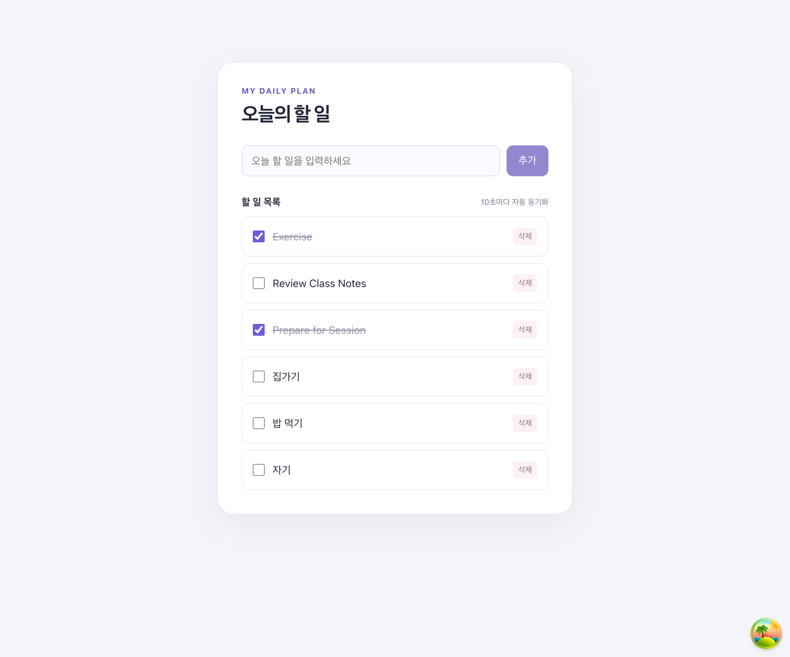

# TanStack Query Todo

TanStack Query와 json-server를 사용해 Todo의 조회, 추가, 완료 상태 변경, 삭제를 구현한 React + TypeScript 프로젝트입니다.

## 실행 방법

의존성을 설치합니다.

```bash
npm ci
```

터미널을 두 개 열어 아래 명령어를 각각 실행합니다.

```bash
# 터미널 1 - json-server API
npx json-server server/db.json
```

```bash
# 터미널 2 - React 앱
npm run dev
```

## 구현 기능

- `useQuery`로 Todo 목록 조회 및 로딩/오류 상태 관리
- `useMutation`으로 Todo 추가, 완료 상태 변경, 삭제 요청 관리
- 완료 상태 변경 시 낙관적 업데이트와 실패 시 Rollback 적용
- 삭제 성공 후 `setQueryData`로 캐시를 직접 수정해 목록 즉시 반영

## 추가 학습 기능 - Polling

세션에서 다루지 않은 기능으로 **쿼리 폴링(Polling)** 을 적용했습니다.

`refetchInterval` 옵션은 일정 시간 간격으로 서버 데이터를 다시 조회합니다. 이 프로젝트에서는 10초마다 Todo 목록을 자동 동기화해, 새로고침하지 않아도 서버의 최신 상태를 반영하도록 구현했습니다.

```ts
export const useTodosData = () => {
  return useQuery({
    queryKey: ["todos"],
    queryFn: fetchTodos,
    staleTime: 1000 * 30,
    refetchInterval: 1000 * 10,
  });
};
```

## 삭제 기능 구현

삭제 버튼을 누르면 `DELETE /todos/{id}` 요청을 보냅니다. 요청이 성공하면 서버가 반환한 ID를 이용해 `setQueryData`에서 해당 Todo만 제거합니다. 따라서 전체 목록을 다시 조회하지 않아도 화면이 즉시 갱신됩니다.

```ts
queryClient.setQueryData<Todo[]>(["todos"], (prevTodos) => {
  return prevTodos?.filter((todo) => todo.id !== deletedId);
});
```

## 실행 화면

삭제 버튼과 10초 자동 동기화 상태가 적용된 Todo 목록입니다.



## 검증

```bash
npm run build
npm run lint
```
